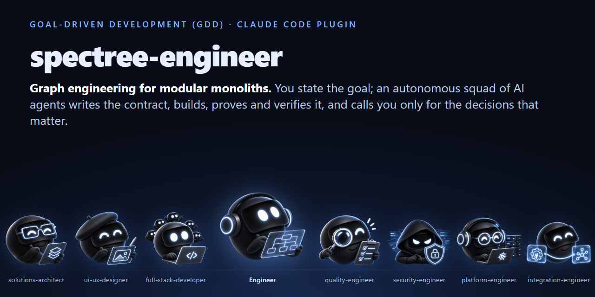

<div align="center">



# spectree-engineer

**Goal-Driven Development (GDD) and graph engineering for modular monoliths, run by an autonomous squad of AI agents.**

A [Claude Code](https://code.claude.com) plugin built on **Goal-Driven Development**, Spectree's own methodology for software built by AI agents. You state the outcome you want. An orchestrator turns it into a contract with provable success criteria. A squad of seven specialist agents plans the work as a graph of tickets, builds it test-first, and gets it verified by agents that did not build it. You come back in only for the decisions that are yours to make.

[](LICENSE)
[](CHANGELOG.md)
[](https://code.claude.com/docs/en/plugins)

[Quick Start](#quick-start) · [How it works](docs/how-it-works.md) · [Architecture rules](ARCHITECTURE.md) · [Contributing](CONTRIBUTING.md)

</div>

> **Your language, English artifacts.** On first contact the Engineer asks, in English, which language you want to talk in, and talks to you in that language from then on. Everything else the squad produces is in English: contracts, code, tests, docs, commits and PRs.

## Goal-Driven Development (GDD)

GDD is the methodology at the core of spectree-engineer. Spectree developed it by running the squad on real projects, and it replaced the earlier flow of specs and planned tickets in version 0.18.0. Spec-driven work hands an agent a plan to follow and accepts its report that the plan is done. GDD hands the agents **only the goal and the way to prove it**, and never takes an agent's word for the result.

1. **The outcome is the input.** You say what should be true when the work is done, never the steps to get there.
2. **A contract, not a spec.** The Engineer writes the goal into `docs/goals/<slug>.md`: the objective, the context, three to seven success criteria each paired with the proof that decides it, the limits, and a budget of verification rounds. It contains no plan.
3. **Whoever builds decides how.** The `full-stack-developer` reads the code and chooses the modules, aggregates and tickets, inside the written architecture rules and nowhere outside them.
4. **Proof is executable.** Each criterion is decided by a command's exit code. `npm run goal -- prove <slug>` runs every proof, and all agents run the same line.
5. **Whoever builds never verifies.** Independent agents attack the contract before any code exists, then attack the proofs and the code after. They never see the builder's plan or report.
6. **Failure narrows; it does not negotiate.** Each round costs budget. A criterion that fails twice must have its whole class of defect closed by construction. A criterion only changes through a dated amendment, and "met with reservations" does not exist.
7. **People decide only what is theirs.** Scope, money, irreversible impact and the undefined go to you. Every other decision is made, recorded in `decisions.md`, and the work moves on.

Abridged example of a contract:

```markdown
# Goal: create-account
Status: approved by engineer under the roadmap approved on 2026-10-30

## Success criteria
| # | Criterion | Proof |
|---|-----------|-------|
| 1 | A signed-in user creates an account with a name, a type and an initial balance, and gets its id back. | run: `npm -w modules/accounts test -- create-account` |
| 2 | A second account with the same name for the same user, in any letter case, is refused with `ACCOUNT_NAME_ALREADY_EXISTS`. | run: `npm -w modules/accounts test -- create-account` |

## Limits
- Out of scope: editing and deactivating accounts.

## Budget
Verification rounds: 3.
```

The full mechanics are in [docs/how-it-works.md](docs/how-it-works.md).

## Why it is different

Most coding agents take a prompt and return a diff. spectree-engineer runs GDD on top of two graphs, and a script checks each one, not a model's opinion.

- **The module graph stays acyclic.** Every generated project follows [19 numbered architecture rules](ARCHITECTURE.md): pure domain modules, one repository per aggregate root, CQRS, errors as codes in a `Result`, and modules that talk through domain events. `scripts/check-boundaries.mjs` enforces the structural rules in `npm test` and in CI. The other rules are checked at the plan gate and in review.
- **The work is a graph of tickets.** A goal is split into vertical-slice tickets with blocking edges. `npm run goal -- graph <slug>` rejects cycles, criteria with no ticket, and parallel tickets that share a folder. It prints the frontier, meaning the tickets free to start. When two tickets on the frontier are independent, they run at the same time in two lanes.
- **The graphs are checked twice.** Before any code, the `solutions-architect` judges the ticket plan against the numbered rules, and `goal graph --plan` must exit 0. At every ticket checkpoint and in final verification, `check-boundaries` runs again on the code.
- **Autonomy has explicit edges.** Outside the interview and the screen prototypes, the squad goes from contract to merged PR on its own. Only four kinds of decision come back to you (see [Where you come in](#where-you-come-in)).

## The squad

| Role | Does | Never does |
|---|---|---|
| **Engineer** (the `/engineer` command) | Talks to you, writes the goal contract, dispatches agents, runs the deterministic gates, records the verdicts | Writes product code, or tells the builder how to build |
| `solutions-architect` | Maps what exists and the seams where a criterion can be proved. At the plan gate, judges the plan against the numbered rules | Writes files |
| `ui-ux-designer` | Prototypes new screens as artboards in a Claude Design artifact, in rounds with you until you approve | Business rules, code |
| `full-stack-developer` | Decides modules, aggregates and tickets, then builds test-first with the monolith scaffolding skills. One fresh agent per ticket | Crosses a contract limit or an architecture rule |
| `quality-engineer` | Runs and attacks every proof, reviews the diff against the project standards and the module boundaries | Edits code; sees the builder's plan |
| `security-engineer` | Reviews the diff as an attacker, using Cloudflare's [security-audit](https://github.com/cloudflare/security-audit-skill) skill | Edits code; reports a finding without a broken trust boundary and a proved impact |
| `platform-engineer` | Bootstrap, CI, Prisma, releases, and git work that needs judgment (conflicts, PRs, merges) | Module code |
| `integration-engineer` | The squad's only route to the web: facts about external APIs, SDKs and versions, always with a source | States a fact from memory |

Every role runs on Claude Opus. A goal moves up to a stronger model only from its third verification round, after two rounds on Opus left a criterion open.

## How a goal flows

```mermaid
flowchart LR
    I([Interview]):::human --> R[Goal roadmap]:::human
    R --> P([Screen prototype]):::human
    P --> C[Contract<br/>criteria + proofs]
    C --> A{{Contract attack<br/>quality-engineer}}
    A --> PL[Plan as a ticket graph<br/>full-stack-developer]
    PL --> G{{Architecture gate<br/>solutions-architect}}
    G --> B[Build ticket by ticket<br/>checkpoint per ticket]
    B --> V{{Final verification<br/>deterministic + QE + SE}}
    V -- not met --> B
    V -- met --> PR[PR, CI green,<br/>auto-merge]
    PR --> N[Retro, next goal]
    N --> C
    classDef human fill:#fde68a,stroke:#b45309,color:#111;
```



Yellow steps involve you. Everything else runs on its own. The full mechanics are in [docs/how-it-works.md](docs/how-it-works.md): the contract, checkpoints, the two lanes, the risk policy, size budgets, and resuming after a usage limit.

### Where you come in

1. **The interview**, once per project: the problem, the first modules, the stack, and three questions the first migration locks in (tenants, roles, password vs. external login). It also covers a risk policy for what may stay open when a goal's round budget runs out.
2. **The roadmap**, approved once. Each goal on it is then approved, and the Engineer writes the success criteria itself.
3. **Screen prototypes**, in as many rounds as you need, before any contract or code.
4. **The four gates**, and nothing else:
   1. **Money and platform:** paid services, paid API keys, infrastructure, deploys.
   2. **Product scope:** anything that changes the approved roadmap or adds a business rule nobody decided.
   3. **Irreversible impact:** destructive migrations on real data, first public exposure, secrets, history rewrites.
   4. **Undefined:** no named best practice decides it, for example a round budget spent with a residue your risk policy does not cover.

Each question comes alone, with a recommendation, so a "yes" moves the squad on.

## Quick Start

### Prerequisites

| | Why |
|---|---|
| [Claude Code](https://code.claude.com) with access to Claude Opus | Runs the orchestrator and the agents |
| Node.js LTS and npm | The generated monorepo and the plugin scripts |
| git, and the [GitHub CLI](https://cli.github.com) (`gh auth login`) | Branches, PRs, CI and auto-merge |
| Docker | PostgreSQL for the generated backend, scratch databases, CI scanners |
| *Recommended:* the Claude desktop app | Runs each roadmap goal in its own linked session; elsewhere the whole project runs in one session. The Engineer panel opens in the desktop app and in VS Code, and screen prototypes are published as Claude Design artifacts |

### 1. Install the plugin

```bash
claude plugin marketplace add Spectree-Tecnologia/spectree-engineer
```

```bash
claude plugin install spectree-engineer@spectree-engineer
```

Check that it is enabled:

```bash
claude plugin list
```

### 2. Start a project

```bash
mkdir my-app && cd my-app && git init
```

```bash
claude
```

### 3. Run the first cycle

In the Claude Code prompt, describe the outcome you want:

```
/spectree-engineer:engineer I want a small app where a single user keeps a list of books they have read, with a rating for each
```

The first time, the Engineer asks which language you want to talk in. It saves your answer in `.engineer.local.json`, which is gitignored because the choice is per person, then picks up your request. Next comes the interview: one question at a time, each with a recommendation, then writes `docs/roadmap.md` for your approval. After you approve, the `platform-engineer` bootstraps the monorepo (Turborepo, NestJS, Prisma + PostgreSQL, Next.js, Vitest), and the first goal, always the `identity` module, starts on its own branch.

Run the command with no arguments at any time to see the project's state, the next step and any pending decision:

```
/spectree-engineer:engineer
```

`/engineer` also works as a short form when no other installed plugin defines a command with that name.

To update later:

```bash
claude plugin update spectree-engineer
```

## What the generated project gets

- **Stack, never pinned:** Turborepo, NestJS (ESM, `nodenext`, Vitest), Next.js with Cache Components, Prisma + PostgreSQL, Node LTS via `.nvmrc`, and a shared `@<ns>/shared` package with the domain base types (`Entity`, `ValueObject`, `Result`, `UseCase`, repositories, `TransactionManager`, `DomainEvent`). Only supported majors, installed at `@latest`.
- **Secure by default:** a global JWT guard (every route closed unless marked `@Public()`), a `JWT_SECRET` with no default, rate limiting, helmet, CORS limited to the frontend URL, a strict `ValidationPipe`, structured JSON logs, an env schema checked at boot, and `/health` and `/ready` probes.
- **Supply chain:** a `.npmrc` with `min-release-age=3`, Dependabot with the same cooldown, `npm audit` in CI, gitleaks, osv-scanner, and squawk on new migrations.
- **Capacity as a test:** a query budget per use case gated on every ready PR, and a p95 budget per route measured nightly and gated before release. The p95 is compared against the base branch on the same machine, so a slow runner does not fail anyone.
- **CI that fits the GitHub Free plan:** one workflow, one job, never on push. Fast checks run on PR pushes, e2e and Playwright smoke run when a PR is ready, the full suite runs nightly, and a pre-release run gates the p95.
- **Disposable databases:** `npm run db:scratch -- <name> -- <command>` creates, migrates, seeds and drops a database around any command, whatever its exit code.
- **Mutation testing** per module with StrykerJS.
- **English UI by default**, with error messages in English and Portuguese (`shared/i18n`) and a place for more locales.

## Repository layout

```
ARCHITECTURE.md        the 19 rules of the modular monolith (copied to docs/architecture.md in every project)
commands/engineer.md   the orchestrator
agents/                the seven specialist agents
skills/engineering/    process skills, vendored from Matt Pocock (MIT)
skills/monolith/       scaffolding skills: config-*, module-*, backend-*, frontend-*
skills/security/       security-audit, vendored from Cloudflare (MIT)
templates/shared/      the @<ns>/shared package copied at bootstrap
hooks/engineer-desk/   the Engineer panel (a Claude Code hooks module)
scripts/               smoke test, eval runner, panel test, art tracer
tests/                 structural guards and tests of the generated project's scripts
evals/                 judgment evals for the agents, run with `claude plugin eval`
```

## The Engineer panel

The plugin ships a Claude Code hooks module, `hooks/engineer-desk/`, which adds a side panel in the desktop app and in VS Code. The panel shows the plan's progress and one card per running subagent, with its role, model, tokens, duration and status. The panel also enforces a few guardrails:

- It raises any dispatch below Opus to Opus.
- It blocks interpreters that would hang waiting on stdin, and `git stash`, whose list every worktree shares.
- Only the Engineer may write a goal contract or keep the plan.
- It warns a `full-stack-developer` to hand off at its 60th tool call.
- It resumes a goal session that stopped on a usage limit or an API error.

The panel never touches the network. Function hooks are an early-access Claude Code API, so the panel may change as that API does.

## Roadmap and limits

Honest limits of the current release:

- **One architecture.** The plugin generates one shape: the TypeScript modular monolith described in [ARCHITECTURE.md](ARCHITECTURE.md). It does not adapt to an existing codebase with a different layout.
- **Some rules are read, not enforced.** Seven architecture rules are enforced by a script and one by the perf and e2e suites. The rest rely on the plan gate and review, and the [CHANGELOG](CHANGELOG.md) lists what each release did not prove.
- **Cost.** A full goal spends many tokens on Opus. `npm run goal -- spent <slug>` reports where they went.

## Contributing

Issues and pull requests are welcome. Start with [CONTRIBUTING.md](CONTRIBUTING.md), which covers the test suites, the versioning rule (every merge to `main` is a release), and Conventional Commits. Please follow the [Code of Conduct](CODE_OF_CONDUCT.md), and report vulnerabilities as described in [SECURITY.md](SECURITY.md).

## Credits and license

The process skills in `skills/engineering/` come from [Matt Pocock's skills](https://github.com/mattpocock/skills). The security review uses [Cloudflare's security-audit skill](https://github.com/cloudflare/security-audit-skill). Rule 15 is adapted from [ponytail](https://github.com/DietrichGebert/ponytail). Details are in [THIRD-PARTY-LICENSES.md](THIRD-PARTY-LICENSES.md).

Released under the [MIT License](LICENSE). Copyright © 2026 Spectree Tecnologia.
